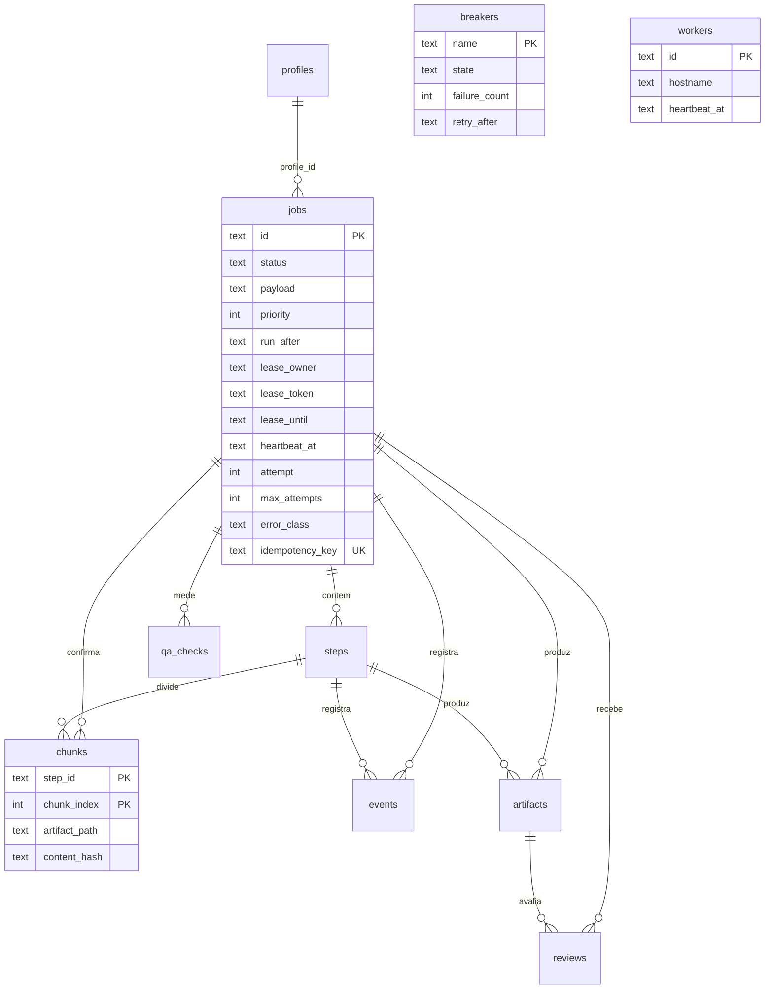

# Dados

O banco da fila é um arquivo SQLite no disco local. Esta página descreve o
caminho, o que cada conexão configura, as tabelas e as migrações. A decisão
de usar SQLite com WAL está na
[ADR 0003](../adr/0003-fila-sqlite-wal.md). O diretório de dados está em
[Configuração](../configuracao.md).

O esquema guarda o estado do job. A mídia continua em arquivo. O banco não
leva chave de API, como na
[ADR 0005](../adr/0005-ia-plugavel-e-keyring.md).

## Onde fica o arquivo

O caminho é `<data_dir>/megila.sqlite3`. `data_dir` vem do modelo de
configuração. O padrão é `$XDG_DATA_HOME/megila`, ou
`~/.local/share/megila` quando `XDG_DATA_HOME` não é um caminho absoluto.
Não há uma segunda chave só para o banco: quem muda `data_dir` muda o
lugar do arquivo.

O arquivo fica em disco local. Não fica em NFS, SMB nem num mount de
nuvem. A [ADR 0006](../adr/0006-local-por-padrao.md) descreve o worker
remoto: ele não abre este arquivo. Recebe um passo pela API local e
devolve artefatos. Só o processo dono do banco grava nele.

Ao lado do arquivo, o modo WAL cria `megila.sqlite3-wal` e
`megila.sqlite3-shm`. Um backup do estado copia os três de forma
consistente, ou usa a API de backup do SQLite. Copiar só o arquivo
principal durante uma escrita não é backup.

## O que acontece ao abrir

`open_database` cria o diretório pai, recusa um filesystem de rede
reconhecido, aplica as migrações e devolve um engine. Cada conexão nova
executa:

```sql
PRAGMA journal_mode = WAL;
PRAGMA synchronous = FULL;
PRAGMA foreign_keys = ON;
PRAGMA busy_timeout = 5000;
```

`journal_mode` fica gravado no arquivo. `foreign_keys` e `busy_timeout`
não ficam: o SQLite começa com a chave estrangeira desligada e sem
espera. Por isso as quatro pragmas correm de novo em toda conexão.
`synchronous=FULL` é o valor `2`. O commit já devolvido sobrevive a uma
falta de energia. A espera de 5000 ms cobre o momento em que outro
processo está no meio de uma transação curta.

No Linux, a abertura lê `/proc/self/mountinfo` e escreve o tipo detectado
no log. Se o tipo for `nfs`, `nfs4`, `cifs`, `smb`, `smb2`, `smb3`,
`fuse.rclone` ou `rclone`, o processo recusa o arquivo e não cria o
diretório. Um tipo que não dá para reconhecer não é recusa: a abertura
segue. Fora do Linux não há essa tabela; o tipo fica desconhecido e a
abertura segue.

As transações são curtas. Transcrição e encode acontecem fora da
transação. O banco guarda o estado, não a mídia.

## Tabelas

São dez: `jobs`, `steps`, `chunks`, `events`, `artifacts`, `reviews`,
`qa_checks`, `profiles`, `breakers` e `workers`. Os instantes são UTC, em
texto `YYYY-MM-DDTHH:MM:SS.mmmZ`. O formato tem largura fixa: a ordem
alfabética é a ordem cronológica.

Apagar um job apaga os passos, pedaços, eventos, artefatos, revisões e
medidas que dependem dele. Nada disso é uma rotina de "limpar a fila". A
[ADR 0003](../adr/0003-fila-sqlite-wal.md) deixa o job `dead` no lugar,
com o pedido intacto.

### jobs

Um item da fila. O claim ainda não roda; as colunas que ele vai usar já
estão aqui.

| Coluna | O que guarda |
| --- | --- |
| `id` | Identificador do job. |
| `status` | `pending`, `leased`, `succeeded` ou `dead`. |
| `payload` | JSON objeto com caminhos e os dois prompts. Sem segredo. |
| `priority` | Inteiro. Número maior sai na frente. O padrão é `0`. |
| `run_after` | Instante UTC a partir do qual o job pode ser pego. |
| `lease_owner` | Id do worker que está com a posse. Não é chave estrangeira. |
| `lease_token` | Token da posse atual. Trabalho nenhum grava checkpoint sem ele. |
| `lease_until` | Fim da posse, em UTC. |
| `heartbeat_at` | Último sinal de vida do dono da posse. |
| `attempt` | Tentativas já gastas. Falha e posse expirada contam. O padrão é `0`. |
| `max_attempts` | Teto. O padrão é `5`. Ao atingir, o status vai a `dead`. |
| `last_error` | Texto do último erro. |
| `error_class` | Classe estável do erro, por exemplo `DiskFull`. |
| `idempotency_key` | Única quando preenchida. Identifica a mesma entrada. Vários `NULL` coexistem. |
| `profile_id` | Perfil usado, ou `NULL`. Apagar o perfil zera esta coluna. |
| `created_at` | Criação, UTC. |
| `updated_at` | Última mudança, UTC. |

`dead` é a fila de falha definitiva. Não há segundo banco. O índice
`ix_jobs_claim` cobre `status`, `priority`, `run_after` e `created_at`.
`ix_jobs_lease` cobre `status` e `lease_until`. O claim futuro lê o
`pending` cujo `run_after` já passou, ou o `leased` cuja posse venceu, em
ordem de prioridade e de criação, com `UPDATE ... RETURNING`.

A chave de idempotência representa a mesma mídia, os dois prompts e o
perfil de encode. O cálculo da chave entra com o comando que enfileira.
A coluna única já impede um segundo job com a mesma chave.

### steps

Um passo do job (`transcribe`, `encode`, `summary` e os que vierem).
`name` e `position` são únicos dentro do job. `position` começa em zero.
`status` é `pending`, `running`, `succeeded`, `failed` ou `skipped`.

### chunks

O pedaço confirmado de um passo longo. A chave primária é
`(step_id, chunk_index)`. É o checkpoint da
[ADR 0003](../adr/0003-fila-sqlite-wal.md): `artifact_path` é o arquivo
final e `content_hash` é o SHA-256 em hexadecimal, com 64 caracteres.
`job_id` está repetido para listar os pedaços do job sem join. A ordem
de gravação continua a da ADR: escrever o temporário, `fsync`, renomear,
e só então inserir a linha. Essa ordem ainda não está no código; a tabela
já exige o hash.

### events

Registro append-only. `kind` é texto livre (`enqueued`, `claimed`,
`heartbeat`, `checkpoint`, `failed`, `dead`, `replayed`). `payload` é um
JSON objeto. `job_id` pode ser nulo num evento do processo. O id é um
inteiro crescente.

### artifacts

Um arquivo que o job produziu (`transcript.json`, `video.mp4`,
`summary.txt`, `qa.json`, `manifest.json`). Os bytes ficam no disco. A
linha guarda caminho, tamanho e, quando existe, o SHA-256. O nome é único
dentro do job.

### reviews

Uma decisão humana sobre o job, e opcionalmente sobre um artefato.
`status` é `pending`, `approved` ou `rejected`. Apagar o artefato zera
`artifact_id` e mantém a revisão.

### qa_checks

Uma medida de qualidade. `name` é único dentro do job (`vmaf`,
`summary`). `status` é `passed`, `failed` ou `skipped`. `score` pode ser
nulo quando o gate não tem número. `detail` é um JSON objeto.

### profiles

Cópia do perfil usado pelo job: prompts, idioma, glossário, interruptores
e o nome do provedor. O documento é o perfil exportado, sem chave. Quem
edita o perfil continua no TOML. Apagar esta linha não apaga o job.

### breakers

Estado de um disjuntor por nome estável (`provider:local`,
`stage:transcribe`). `state` é `closed`, `open` ou `half_open`.
`failure_count` conta falhas, `threshold` é o teto, `retry_after` é o
instante em que um disjuntor aberto pode ser tentado de novo. A tabela
guarda o estado. Ela ainda não abre nem fecha o disjuntor.

### workers

Um processo que pode segurar uma posse. Guarda hostname, pid, início,
sinal de vida e parada. `jobs.lease_owner` cita o id em texto, de
propósito sem chave estrangeira: o job continua legível se a linha do
worker sumir.

## Diagrama



`workers` não tem linha até `jobs` no diagrama: `lease_owner` não é chave
estrangeira.

## Migrações

O esquema usa SQLAlchemy 2 e Alembic. Os dois são MIT, como pede a
[ADR 0002](../adr/0002-licenca-mit-sem-codigo-agpl.md). Os scripts ficam em
`megila.jobs.queue.migrations`. A revisão inicial é `0001_initial`.

`upgrade_database` leva o arquivo até `head`. `downgrade_database` sem
argumento volta a `base` e apaga as dez tabelas; o arquivo SQLite
permanece. `open_database` faz o upgrade e devolve o engine.

```python
from megila.config import load_settings
from megila.jobs.queue import open_database

engine = open_database(load_settings())
```

## O que esta versão não faz

O claim atômico (`UPDATE ... RETURNING`), a renovação do sinal de vida, o
consumo de `attempt` e a ida a `dead` ainda não rodam. Também não roda a
conferência do hash na retomada. As colunas e as chaves já estão no
esquema para esse código não precisar de outra migração só para existir.
O padrão de duração da posse continua o da
[ADR 0003](../adr/0003-fila-sqlite-wal.md): 60 segundos, registrados no
`lease_until` quando o claim existir.
