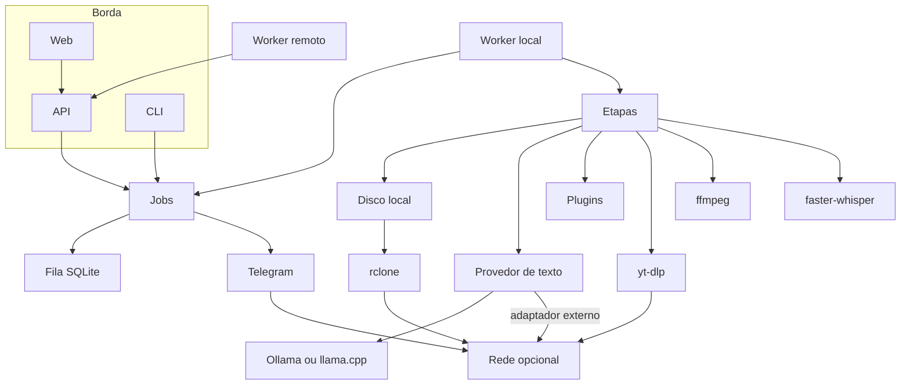
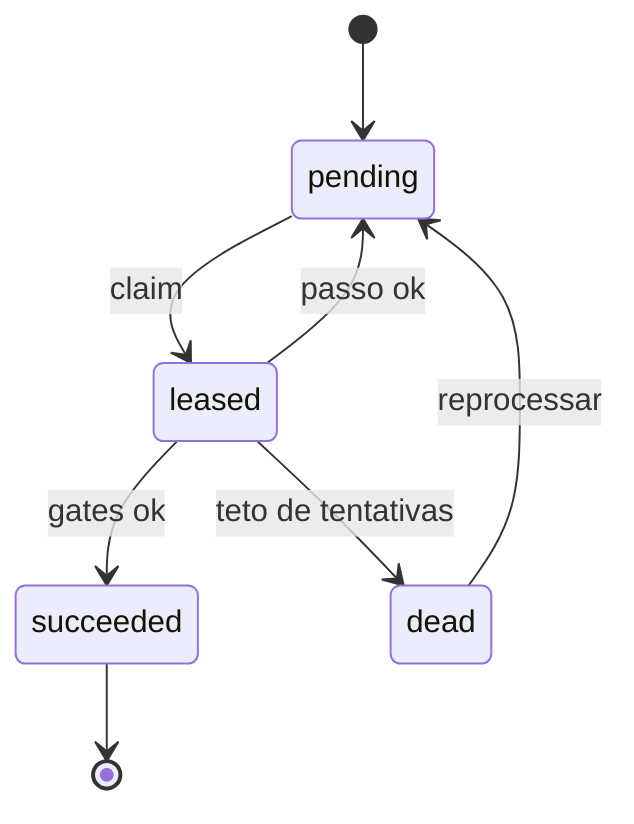
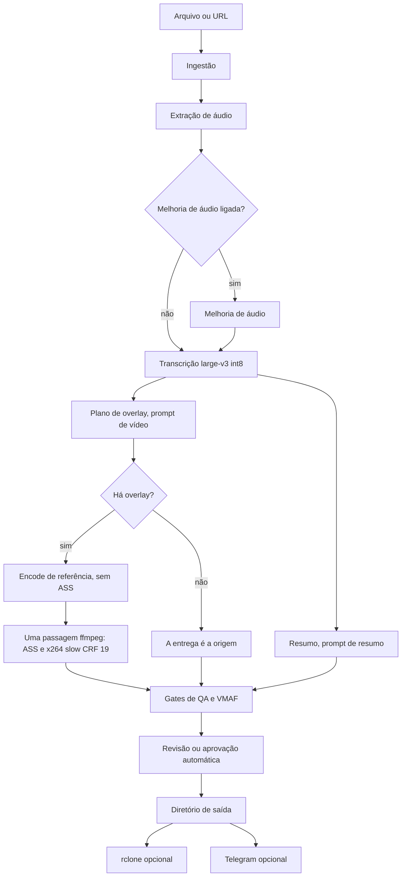

# Arquitetura

O Megila é um pipeline genérico de vídeo. Quem usa entrega um arquivo ou,
se quiser, uma URL, junto com dois prompts: um para ajustes e overlays,
outro para o resumo. O resultado é um diretório. A orquestração é Python,
a licença é MIT, e o autor é Renan Scalet. O nome vem de Jeremias 36:2.

Esta página é o mapa dos componentes e do fluxo. O contrato fechado está
nas [decisões arquiteturais](../adr/index.md). O que já roda está no
código em `src/megila`. Os dois têm de aparecer aqui juntos.

!!! warning "Atualize esta página quando um componente mudar"
    Componente, etapa, provedor, plugin, disjuntor ou ADR ligada desta
    página não muda em silêncio. O mesmo pull request atualiza o diagrama,
    a tabela de estado e o texto da seção. Uma página atrasada é documentação
    errada: alguém implementa o desenho velho ou procura no código uma
    etapa que esta página ainda trata como futura.

## Como ler o estado

| Estado | O que significa |
| --- | --- |
| Existe | O código em `src/megila` faz isso hoje. |
| Decidido | Uma ADR aceita fecha o contrato. O módulo reserva o lugar e ainda não executa o contrato. |
| Planejado | Não há ADR nem implementação. O texto desta página guarda a intenção até existir decisão. |

Existe é o que roda hoje. Decidido e planejado ainda não rodam. A diferença
é se o contrato já foi aceito numa ADR ou se ainda é esboço.

## O que existe hoje

A versão do pacote é 0.1.0. As dependências de runtime incluem o Typer,
o Pydantic, o SQLAlchemy e o Alembic. O comando `megila --version` (e
`python -m megila --version`) imprime a versão e encerra. Não há
subcomando de job.

Os subpacotes abaixo são importáveis. A configuração e o esquema da fila
já rodam. O claim do job, as etapas, a API, o provedor e o plugin ainda
não executam. Não há aplicação React no repositório.

| Módulo | Estado | Lugar no mapa |
| --- | --- | --- |
| `megila.cli` | Existe | Linha de comando. Hoje só a versão. |
| `megila.api` | Planejado | HTTP com FastAPI, chamando o mesmo núcleo da CLI. |
| `megila.config` | Existe | Configuração em camadas e perfis. Sem segredo no arquivo. |
| `megila.jobs` | Decidido | Ciclo de vida do job. Contrato espalhado pelas ADRs 0003 a 0006. |
| `megila.jobs.queue` | Existe | Esquema SQLite, pragmas e migrações. O claim ainda não roda. [Dados](dados.md). |
| `megila.stages` | Decidido | Etapas. O pacote cita ingerir, transcrever, overlay, encode e gate. |
| `megila.providers` | Decidido | Porta de texto. O pacote nomeia Ollama e llama.cpp no caminho local. |
| `megila.plugins` | Planejado | Registro de etapas, provedores e notificadores. |
| `megila.notify` | Planejado | Saída de aviso. O pacote reserva o Telegram. |
| `megila.storage` | Existe | Escrita atômica de um arquivo. O backup rclone segue decidido e ainda não roda. |

Os testes já sabem gerar um clipe sintético, descrito em
[Amostras de teste](../dev/amostras.md). Esse clipe não é uma etapa do
pipeline. Serve para exercitar, no futuro, transcrição, queima de ASS e
VMAF sem mídia de terceiros.

## Linguagem, licença e custo

**Decidido.** A [ADR 0001](../adr/0001-python-nao-rust.md) fixa Python 3
(CPython) na orquestração. O tempo do job continua no CTranslate2, por
baixo do faster-whisper, e no libx264, por baixo do ffmpeg. ffmpeg,
ffprobe, yt-dlp e rclone são programas externos. O processo Python os
chama com lista de argumentos, sem shell. Eles não são vendorizados.

**Decidido.** A [ADR 0002](../adr/0002-licenca-mit-sem-codigo-agpl.md)
mantém o repositório na licença MIT do arquivo `LICENSE`. Código sob
GPL, AGPL ou SSPL não entra, nem como dependência Python. Cortes curtos
não fazem parte deste fluxo. Quando tiverem desenho, será uma ADR nova,
escrita a partir de requisitos daqui, sem trazer código de projeto AGPL.

**Decidido.** O caminho padrão não pede conta, não chama API paga e não
envia telemetria. Provedor de texto externo, remote do rclone e worker
em Colab, se alguém os ligar, saem da conta dessa pessoa. O custo do
projeto permanece zero. Isso está na
[ADR 0005](../adr/0005-ia-plugavel-e-keyring.md) e na
[ADR 0006](../adr/0006-local-por-padrao.md).

## Mapa dos componentes

A borda recebe o pedido e o entrega ao núcleo. O núcleo guarda o estado
e executa as etapas. O disco local é a entrega. A rede só entra quando
uma opção está ligada, e essa saída passa pelo disjuntor planejado.

O estado de cada bloco está nas tabelas desta página, não dentro das
caixas. ffmpeg, o faster-whisper, os plugins e o motor local ficam na
máquina. A caixa "Rede opcional" é a saída do disjuntor planejado:
yt-dlp, adaptador de texto externo, Telegram e rclone.

### CLI

**Existe** o programa Typer, com `--version` e `-V`. **Planejado** o
restante da linha de comando: submeter um job, consultar o status e
apontar o diretório de saída. A CLI chama o mesmo núcleo que a API.

### API e interface web

**Planejado.** `megila.api` será uma aplicação FastAPI. Ela chama o
mesmo núcleo da CLI. A interface web, em React com Vite, fala só com
essa API. A regra de negócio fica nesse núcleo.

A API também é a porta do worker remoto. A
[ADR 0006](../adr/0006-local-por-padrao.md) manda escutar em `127.0.0.1`
por padrão. Abrir o alcance, túnel SSH inclusive, é configuração
explícita. Quando o worker não está na mesma máquina, ele apresenta um
token guardado no keyring.

Não há, hoje, dependência FastAPI no `pyproject.toml` nem diretório de
frontend.

### Worker

**Decidido** na [ADR 0003](../adr/0003-fila-sqlite-wal.md) e na
[ADR 0006](../adr/0006-local-por-padrao.md). **Não há código** além do
pacote `megila.jobs`.

O padrão é um worker local e um job pesado por vez. A máquina alvo não
tem GPU nem folga para dois `large-v3` ou dois encodes em preset `slow`.
Um worker remoto é opcional. Ele pode ser um Colab da conta de quem usa,
ou outra máquina sob controle dessa pessoa. Não é serviço hospedado pelo
projeto. GPU, se existir, acelera o mesmo perfil de qualidade. Não cria
um perfil mais fraco.

O processo local continua dono da fila. O worker remoto não recebe o
arquivo SQLite e não o abre pela rede. Recebe as entradas de um passo e
devolve artefatos. O processo local confere o hash e grava o checkpoint.

### Fila SQLite com WAL

**Decidido** na [ADR 0003](../adr/0003-fila-sqlite-wal.md). O esquema
normativo, as pragmas e os testes de confirmação estão lá. Esta seção
não é uma segunda cópia: se divergir, vale a ADR.

O código já abre o banco, recusa filesystem de rede reconhecido, aplica
as pragmas e migra o esquema com Alembic. O arquivo é
`<data_dir>/megila.sqlite3`. As tabelas estão em [Dados](dados.md). O
claim, o sinal de vida e a ida a `dead` descritos abaixo são o contrato.
Ainda não rodam.

O banco fica num filesystem local, no diretório de dados do Megila. Na
abertura, um tipo reconhecível como rede ou como FUSE de nuvem (`nfs`,
`cifs`, `smb`, `fuse.rclone` e equivalentes) faz o processo recusar
subir. O modo é WAL, com `synchronous=FULL`. A transcrição e o encode
acontecem fora da transação. O banco guarda estado, não mídia.

O payload é JSON com caminhos e com os dois prompts. Não leva segredo
de API. A chave de idempotência é a identidade da mídia, os dois prompts
e o perfil de encode. Reenviar o mesmo pedido devolve o job já criado.

Quatro status: `pending`, `leased`, `succeeded`, `dead`.

O heartbeat renova o lease e não muda o status. Por isso não aparece
como transição.

**Lease.** Posse temporária do job por um worker. O padrão dura 60
segundos e é configurável. O claim roda em `BEGIN IMMEDIATE`. O worker
leva o job `pending` mais antigo, ou o `leased` cujo `lease_until` já
passou. Trabalho nenhum começa sem um `lease_token` novo.

**Heartbeat.** Sinal de vida. A cada 20 segundos, dentro desses 60, o
worker renova `lease_until` e `heartbeat_at` só se o token ainda for o
dele. Zero linhas atualizadas significa que a posse acabou: o worker
para e não grava mais checkpoint. Um `SIGTERM` deixa de renovar. O lease
expira e outro worker retoma do último pedaço confirmado. O sinal não
marca o job como `succeeded`.

**Tentativas.** Erro de execução, ou lease expirado, consome uma
tentativa. O padrão de `max_attempts` é 5. No teto, o status vai a
`dead`. Não há retry infinito. Enquanto ainda há tentativa, o job
continua reivindicável (`pending`, ou `leased` com o lease vencido). A
ADR não cria um quinto status para essa espera. Devolver o job no fim
de um passo bem-sucedido não consome tentativa: o worker grava o
checkpoint e pode seguir no mesmo lease ou voltar o status a `pending`.

**DLQ.** O status `dead` é a dead-letter queue, a fila de falha
definitiva, no mesmo banco. Payload, `last_error` e checkpoints
permanecem. Reprocessar é transição explícita de `dead` para `pending`:
zera `attempt`, troca o token e mantém todo checkpoint cujo arquivo
ainda produz o mesmo hash.

**Checkpoint em pedaços.** Transcrição e encode gravam pedaços. A ordem
é escrever o artefato num caminho temporário, `fsync` do arquivo e do
diretório, renomear para o caminho final, e só então inserir a linha. A
inserção só conta se o token ainda for o dono e o lease não tiver
expirado. O hash é SHA-256 do arquivo final. Na retomada, linha e
arquivo com o mesmo hash pulam o pedaço; linha sem arquivo, hash
diferente, ou arquivo sem linha, refazem o pedaço. Disco cheio falha a
transação. Um mp4 truncado não vira sucesso.

Os números 60 segundos, 20 segundos e 5 tentativas são o padrão. Um job
pode configurá-los. O valor efetivo fica no manifesto desse job.

Backup do estado copia o arquivo principal, o `-wal` e o `-shm` de forma
consistente, ou usa a API de backup do SQLite. Copiar só o arquivo
principal durante uma escrita não é backup.

### Disjuntor

**Planejado** como comportamento. Não há ADR. A tabela `breakers` já
está no banco da fila para guardar nome, estado, contagem e
`retry_after`. Nada abre nem fecha o circuito. No mapa, a caixa "Rede
opcional" é o lugar deste esboço. Disjuntor aqui é o circuit breaker
das chamadas de rede opcionais: adaptador de texto externo, yt-dlp,
Telegram e rclone.

Quando a dependência falha em sequência, o circuito abre e a chamada
seguinte falha na hora, com erro claro, em vez de ficar pendurada até
esgotar o tempo. Essa falha continua sendo erro do job, no contrato da
[ADR 0003](../adr/0003-fila-sqlite-wal.md). O disjuntor não cria retry
infinito, não apaga a DLQ e não promove status. ffmpeg, faster-whisper
e o motor de texto local não dependem dele.

O lugar do estado é a tabela `breakers`. A política que abre o circuito,
o limiar efetivo e a meia-abertura ainda não rodam. Se virarem política
durável, entram numa ADR. O estado do disjuntor não é segredo.

## Fluxo de ponta a ponta

O fluxo abaixo é o desenho alvo. Cada caixa está marcada na tabela. Uma
caixa decidida já tem contrato de ADR e ainda não tem código de etapa.
Uma caixa planejada ainda não tem os dois.

| Etapa | Estado | Onde está o contrato |
| --- | --- | --- |
| Ingestão de arquivo | Planejado | Cópia local. A web envia o arquivo à API. |
| yt-dlp | Decidido | Só quando a entrada é URL. ADRs [0001](../adr/0001-python-nao-rust.md) e [0006](../adr/0006-local-por-padrao.md). |
| Extração de áudio | Planejado | ffmpeg, arquivo no diretório do job. |
| Melhoria de áudio | Planejado | Opcional e desligada por padrão. Sem filtro escolhido. |
| Transcrição | Decidido | `large-v3`, `int8`. [ADR 0004](../adr/0004-qualidade-em-primeiro-lugar.md). |
| Plano de overlay | Decidido | Prompt de vídeo, lista estruturada. ADRs [0004](../adr/0004-qualidade-em-primeiro-lugar.md) e [0005](../adr/0005-ia-plugavel-e-keyring.md). |
| Encode de referência | Decidido | Sem ASS, para o VMAF. [ADR 0004](../adr/0004-qualidade-em-primeiro-lugar.md). |
| Entrega ASS + x264 | Decidido | Uma passagem ffmpeg. [ADR 0004](../adr/0004-qualidade-em-primeiro-lugar.md). |
| Resumo | Decidido | Várias passagens, o prompt manda no texto. [ADR 0004](../adr/0004-qualidade-em-primeiro-lugar.md). |
| Gates de QA e VMAF | Decidido | Falha fechada. [ADR 0004](../adr/0004-qualidade-em-primeiro-lugar.md). |
| Revisão ou aprovação automática | Planejado | Aprovação automática segue os gates. Revisão humana sem desenho. |
| Diretório de saída | Decidido | A entrega é local. ADRs [0004](../adr/0004-qualidade-em-primeiro-lugar.md) e [0006](../adr/0006-local-por-padrao.md). |

A melhoria de áudio sai do caminho quando está desligada. Sem overlay
pedido, não há as duas passagens de encode: a origem é a entrega. O
resumo lê a transcrição e o prompt de resumo. Não lê o pixel do vídeo.
rclone e Telegram não decidem o sucesso do job. A falha deles não
apaga o diretório.

### Ingestão

**Planejado** para o arquivo. **Decidido** para a URL.

Quem já tem o arquivo entrega um caminho, na CLI, ou envia os bytes pela
interface web, quando ela existir. O job fica com uma cópia no disco
local. O payload da fila guarda o caminho, não o binário. A identidade
dessa mídia entra na chave de idempotência.

Quando a entrada é uma URL, o yt-dlp baixa a mídia. Esse é o uso de rede
esperado nesse job. Quem já tem o arquivo não passa pelo yt-dlp. A
chamada usa lista de argumentos, sem shell, como na
[ADR 0001](../adr/0001-python-nao-rust.md).

### Extração de áudio

**Planejado.** O faster-whisper consome áudio. Uma etapa, via ffmpeg,
extrai a faixa para um arquivo no diretório do job. A mídia não entra no
SQLite.

Arquivo sem faixa de áudio falha nesta etapa, com erro claro. O job não
inventa transcrição. Áudio presente e sem fala segue para a transcrição:
lá o gate da [ADR 0004](../adr/0004-qualidade-em-primeiro-lugar.md)
recusa um vídeo sem fala, em vez de fabricar resumo.

### Melhoria de áudio

**Planejado.** Etapa opcional, desligada por padrão, entre a extração e
a transcrição. Nenhum filtro foi escolhido e não há ADR.

Desligada, a transcrição recebe o áudio extraído sem alteração. Ligada,
o manifesto do job registra que ela rodou, no mesmo hábito da
[ADR 0004](../adr/0004-qualidade-em-primeiro-lugar.md), que já guarda a
escolha do filtro de voz. A melhoria não afrouxa o modelo, o beam nem os
gates.

### Transcrição

**Decidido** na [ADR 0004](../adr/0004-qualidade-em-primeiro-lugar.md).
O modelo padrão é o `large-v3` do faster-whisper, com `compute_type`
`int8`. A busca usa `beam_size` 5. O filtro de voz padrão fica ligado. A
língua é detectada, salvo se o job fixar uma. A saída traz segmentos e
tempo por palavra, porque o overlay precisa da fala alinhada.

A transcrição não passa pela porta de texto da
[ADR 0005](../adr/0005-ia-plugavel-e-keyring.md). Trocar o faster-whisper
por uma API de fala não faz parte da decisão. Quem executa é a
biblioteca local, sobre o CTranslate2, como na
[ADR 0001](../adr/0001-python-nao-rust.md).

### Plano de overlay

**Decidido** nas ADRs [0004](../adr/0004-qualidade-em-primeiro-lugar.md)
e [0005](../adr/0005-ia-plugavel-e-keyring.md). O modelo de texto recebe
o prompt de vídeo e devolve uma lista estruturada: início, fim, texto e
a intenção de estilo. Não escreve o ASS final e não escreve filtro de
ffmpeg.

O compilador do Megila gera `overlays.ass` com um subconjunto seguro de
tags. O formato é ASS, renderizado pelo libass via ffmpeg. SRT não
expressa a posição e o estilo que o prompt pede. O arquivo ASS entra no
diretório de saída, editável, além de ir queimado na entrega.

### Queima do ASS e compressão

**Decidido** na [ADR 0004](../adr/0004-qualidade-em-primeiro-lugar.md).

A entrega com overlay, `video.mp4`, sai de uma passagem do ffmpeg. Nesse
processo o filtro `ass` queima `overlays.ass` e o `libx264` comprime, com
preset `slow`, CRF 19 e pixel `yuv420p`. O áudio é copiado quando o
contêiner aceita. Quando a cópia é impossível, o áudio vira AAC a
256 kb/s. Não há um segundo arquivo "mais comprimido" com outro CRF.
Compactar não autoriza subir o CRF nem trocar o preset.

A medida de qualidade não pode tratar o texto pedido como defeito. Por
isso existe uma passagem anterior, sem o filtro `ass`: `video-quality.mp4`,
com o mesmo `libx264`, preset `slow` e CRF 19. O VMAF mede esse arquivo
contra a origem. As duas passagens custam tempo. O custo fica aceito
enquanto esta ADR estiver em vigor. Fundir as duas numa só, e medir o
VMAF em cima do texto queimado, exigiria outra ADR.

Se o prompt não pede overlay, o programa não reencoda por hábito. A
entrega é a própria origem, o hash dela entra no relatório e o VMAF não
se aplica.

### Resumo

**Decidido** na [ADR 0004](../adr/0004-qualidade-em-primeiro-lugar.md).
O texto obedece ao prompt de resumo e a mais nada. O programa não
acrescenta título, sumário, tópicos nem rodapé. O nome `summary.txt` é
contrato do Megila. O prompt manda no texto, não no caminho.

Há três papéis, todos no modelo de texto da
[ADR 0005](../adr/0005-ia-plugavel-e-keyring.md):

1. Escrita: recebe o prompt e o material (a transcrição e o que o prompt pedir) e produz o rascunho.
2. Verificação: recebe o prompt e o rascunho e lista violações objetivas. Não reescreve.
3. Correção: reescreve a partir do prompt, do rascunho e da lista.

A verificação e a correção repetem até a lista vir vazia, no máximo três
correções. Se ainda houver violação, o resumo não está aprovado. O
último rascunho fica em `summary.draft.txt`. O arquivo aprovado,
`summary.txt`, só existe em UTF-8, com os bytes do texto aceito, sem
embrulho.

### Gates de QA e VMAF

**Decidido** na [ADR 0004](../adr/0004-qualidade-em-primeiro-lugar.md).
Todos os gates rodam em todo job. Falha deixa o job fora de
`succeeded`, conserva o diretório para diagnóstico e devolve o caso à
fila, rumo a retry ou a `dead`, como na
[ADR 0003](../adr/0003-fila-sqlite-wal.md). O relatório `qa.json` guarda
cada resultado.

O mínimo, em resumo:

- Transcrição presente, com segmentos coerentes e palavra dentro do segmento pai. Vídeo sem fala falha.
- ASS saído do compilador do Megila, e ffmpeg da queima com código 0. Sem overlay pedido, o gate registra a ausência.
- VMAF do `video-quality.mp4` contra a origem, libvmaf, modelo `vmaf_v0.6.1` (ou `vmaf_4k_v0.6.1` se a altura passar de 1080). Piso padrão 90. Sem nota, o gate reprova. Sem reencode, o VMAF não se aplica e o hash da origem entra no relatório.
- A diferença de duração entre `video.mp4` e `video-quality.mp4` não passa de 0,1 s.
- Resumo: verificação sem violação e `summary.txt` presente.
- A build do ffmpeg usada no job contém `libx264`, `libass` e `libvmaf`. Falta qualquer uma, o gate falha fechado.

`manifest.json` guarda o id do job, a identidade da origem, os dois
prompts, o perfil efetivo e as versões do ffmpeg e do faster-whisper.
O arquivo fica sem segredo de API.

### Revisão ou aprovação automática

**Planejado.** Não há módulo nem ADR para uma fila de revisão humana.

A aprovação automática é o desfecho já descrito na
[ADR 0004](../adr/0004-qualidade-em-primeiro-lugar.md): todos os gates
passaram, o job vai a `succeeded`, o diretório é a entrega. Esse é o
padrão pretendido. O job comum não espera uma pessoa.

A revisão humana seria um modo opcional, desligado por padrão, entre os
gates e o `succeeded`. O que uma recusa humana faz com o status ainda
não está decidido. Não entra nesta página como regra. Quando entrar,
será com ADR, e o padrão continua sendo não esperar alguém.

### Diretório de saída

**Decidido** nas ADRs [0004](../adr/0004-qualidade-em-primeiro-lugar.md)
e [0006](../adr/0006-local-por-padrao.md). O diretório do job, na
máquina, é a entrega. O job se conclui quando esse diretório está
pronto.

| Arquivo | Quando aparece |
| --- | --- |
| `transcript.json` | A transcrição chegou a ser escrita e conferida. |
| `overlays.ass` | Havia overlay pedido. |
| `video-quality.mp4` | Houve encode de referência. |
| `video.mp4` | Houve a passagem de entrega com ASS. Sem reencode, a entrega é a própria origem. |
| `summary.txt` | O resumo passou na verificação. |
| `summary.draft.txt` | O resumo esgotou as correções sem ficar limpo. |
| `qa.json` | Sempre, com o resultado de cada gate. |
| `manifest.json` | Sempre, sem segredo. |
| `backup.json` | Uma tentativa de backup chegou a rodar. Fica no disco local. |

## Notificações

**Planejado.** `megila.notify` reserva o Telegram. O pacote ainda não
escolhe o texto, não lê token e não envia mensagem.

O aviso anuncia mudança de status. A entrega continua sendo o diretório.
O aviso também não altera `succeeded` nem `dead`. O token do bot fica no
keyring, no serviço `megila`. Não entra em log, no payload, no
`manifest.json`, no `qa.json` nem no diretório de saída. A
[ADR 0005](../adr/0005-ia-plugavel-e-keyring.md) ainda não cita o
Telegram pelo nome. A mesma regra de segredo se aplica quando o
notificador existir: o processo redige o valor, o cabeçalho
`Authorization` e query string com segredo, e não loga corpo de pedido
nem corpo de resposta.

A chamada ao Telegram passa pelo disjuntor planejado. Telegram desligado
é o padrão, no espírito da
[ADR 0006](../adr/0006-local-por-padrao.md): o job comum não fala com a
rede.

## Backup

**Decidido** na [ADR 0006](../adr/0006-local-por-padrao.md). A cópia que
importa já está no disco local. O backup para fora é opcional e usa o
rclone que a pessoa já autenticou. O Megila não embute SDK do Google,
não lê token de Drive e não pede client id. Qualquer remote rclone
serve. Drive é um exemplo de remote, não uma dependência.

O comando é `rclone copy` do diretório do job para
`<remote>:<prefixo>/<id-do-job>`, sem apagar a cópia local, com lista de
argumentos e sem shell. O backup começa depois que o job já tem estado
terminal (`succeeded` ou `dead`). A falha do rclone não apaga a saída,
não promove um `dead` a `succeeded` e não derruba um `succeeded` a
`dead`. O resultado fica em `backup.json`, no disco local, com o nome do
remote, o instante e o sucesso ou o erro. A credencial continua no
arquivo de configuração do rclone, fora do Megila.

Apontar o SQLite para um mount do rclone é o cenário que a
[ADR 0003](../adr/0003-fila-sqlite-wal.md) recusa na abertura do banco.
Backup não é "montar a nuvem e guardar a fila lá".

## Provedores de texto

**Decidido** na [ADR 0005](../adr/0005-ia-plugavel-e-keyring.md). A porta
é uma só. Transcrição não passa por ela. Um provedor implementa completar
texto, com uma instrução de sistema e o texto de quem usa, e devolve
texto. Não recebe a chave como argumento. Quem precisa de chave a lê
dentro do adaptador, na hora da chamada, e não a guarda num atributo que
um traceback ou um `repr` mostre.

O provedor padrão se chama `local`. Não abre conexão externa e não
consulta o keyring. O pacote `megila.providers` nomeia os dois motores
locais previstos primeiro: Ollama e llama.cpp. Os dois ficam atrás desse
provedor, na máquina. Ollama, nesse papel, é um servidor local. Apontar
a URL para fora da máquina deixa de ser o provedor `local` e passa a ser
adaptador externo. A ADR não prende o projeto a um binário: o motor
concreto é configuração. Se o motor local falta, o passo que precisa do
modelo falha com erro claro. O Megila não escolhe um fornecedor pago
escondido. A transcrição, que não usa esta porta, segue disponível.

Um provedor externo é opcional. A ADR fixa um adaptador HTTP no
subconjunto compatível com a API da OpenAI. A configuração leva o
provedor, o modelo, a URL base e a identidade da conta no keyring. Não
leva o segredo. Gemini, OpenAI e OpenRouter entram por essa porta quando
o endpoint deles falar esse subconjunto: são configuração, não quatro
SDKs. Anthropic fala outro protocolo. O adaptador próprio continua
**planejado**, atrás da mesma porta, com a chave só no keyring. Nenhum
desses quatro nomes está implementado.

A chave é lida com a biblioteca `keyring`, no serviço `megila` e na
conta configurada. O chaveiro é o do sistema operacional. Se o backend
não estiver disponível, o provedor externo não liga. O processo explica
o que falta e não cai para arquivo, variável de ambiente persistida nem
tabela SQLite. O provedor `local` continua funcionando sem chave.

O valor lido não entra no payload do job, não entra no `manifest.json`
nem no `qa.json`, e não é escrito no diretório de saída. Um filtro de
log redige o segredo, o cabeçalho `Authorization` e qualquer query
string que carregue segredo. Corpo de pedido e corpo de resposta não são
logados. O que pode ser logado é o nome do provedor, o id do modelo, o
nome da conta no keyring (não o segredo), a latência, a contagem de
tokens se o provedor a informar, e o código HTTP.

O plano de overlay e as três passagens do resumo usam essa porta. Trocar
de motor não reescreve o compilador de ASS nem o gate do resumo.

## Plugins

**Planejado.** `megila.plugins` será o lugar em que código de extensão
registra etapas, provedores e notificadores. Não há interface de
registro implementada.

O exemplo de produto é um plugin de Bíblia ou de hinário. Ele só lê
arquivos que a pessoa fornece: texto, áudio, índice, no caminho que ela
configurar. O repositório não distribui escritura, partitura nem
fonograma, e o plugin não baixa esse material de uma API. Isso respeita
a barreira de licença da
[ADR 0002](../adr/0002-licenca-mit-sem-codigo-agpl.md) e o padrão local
da [ADR 0006](../adr/0006-local-por-padrao.md).

O plugin pode entregar trechos, tempos ou referências ao planejamento de
overlay, ou registrar uma etapa sua. O núcleo continua dono da fila, do
encode, dos gates e do diretório de saída. Um plugin não abre o SQLite
de outro processo e não guarda chave de API em arquivo próprio.

## Decisões que esta página segue

| ADR | Decisão | O que ela segura nesta página |
| --- | --- | --- |
| [0001](../adr/0001-python-nao-rust.md) | Python, e não Rust | Orquestração em CPython. ffmpeg, ffprobe, yt-dlp e rclone por lista de argumentos. |
| [0002](../adr/0002-licenca-mit-sem-codigo-agpl.md) | Licença MIT e nenhum código AGPL | Sem código copyleft forte. Plugin de Bíblia ou hinário não traz obra de terceiros. Sem cortes curtos neste fluxo. |
| [0003](../adr/0003-fila-sqlite-wal.md) | Fila própria em SQLite com WAL | Lease, heartbeat, DLQ, checkpoint em pedaços. Um escritor, no disco local. |
| [0004](../adr/0004-qualidade-em-primeiro-lugar.md) | Qualidade antes da velocidade | Transcrição, ASS, encode, resumo e gates. Duas passagens de ffmpeg quando há overlay. |
| [0005](../adr/0005-ia-plugavel-e-keyring.md) | IA plugável, local por padrão, segredo no keyring | Porta de texto, motor local, chave no keyring, log sem segredo. |
| [0006](../adr/0006-local-por-padrao.md) | Local por padrão | API em `127.0.0.1`, worker remoto opcional, backup rclone opcional, sem telemetria. |

Uma ADR nova que mude qualquer linha desta tabela atualiza esta página
no mesmo commit. O modelo de ADR está em
[docs/adr/template.md](../adr/template.md).

## Manter esta página

A regra está no aviso do topo. O checklist de quem mexe num componente:

- Módulo novo em `src/megila`: uma linha na tabela do que existe hoje e, se ele fala com outro bloco, uma seta no mapa.
- Etapa nova, etapa removida ou ordem diferente: a tabela do fluxo, o diagrama de ponta a ponta e a seção da etapa.
- Estado que mudou de planejado para código que roda: trocar a marca para existe e descrever o que o código faz, não o que a página esperava.
- ADR nova, ADR substituída, ou número que a ADR mudou (lease, CRF, piso de VMAF, tentativas): atualizar o parágrafo e o link. Não deixar um número velho convivendo com a ADR.
- Provedor, plugin ou notificador novo: a seção correspondente e, se usar rede, a lista do disjuntor.

O diagrama não é enfeite. Se ele mente, a página mente. Quem só lê a
figura tem de ver o mesmo desenho de quem lê o texto.
