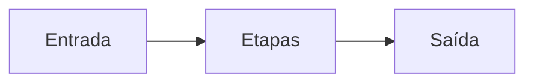

# Como escrever a documentação

O site é um projeto MkDocs à parte do pacote Python. As dependências de
build ficam em `docs/requirements.txt`. O workflow
`.github/workflows/docs.yml` roda `mkdocs build --strict` em cada pull
request e publica o site no GitHub Pages a cada push na `main`.

O endereço público é `https://scalet.github.io/megila/`. Ele passa a
responder quando o GitHub Pages estiver ligado à origem GitHub Actions.

## Publicação

O job de deploy só sobe o site em push na `main` (ou num disparo manual do
workflow na `main`). Pull requests apenas constroem o site.

Uma vez, em **Settings → Pages → Build and deployment**, a origem precisa
ser **GitHub Actions**. Sem isso o deploy falha; o build estrito dos pull
requests continua valendo. O repositório público usa o GitHub Pages e o
GitHub Actions gratuitos. Depois de ligar a origem, o workflow `Docs` pode
ser disparado de novo em Actions, sem um commit vazio.

## Visualizar localmente

É preciso Python 3.11 ou mais novo. O CI usa 3.12.

```bash
python -m venv .venv
source .venv/bin/activate
python -m pip install -r docs/requirements.txt
mkdocs serve
```

Abra <http://127.0.0.1:8000/>. O `mkdocs serve` recarrega a página quando
você salva um arquivo. Antes de abrir o pull request, rode o mesmo comando
do CI:

```bash
mkdocs build --strict
```

A pasta `site/` é gerada localmente e não entra no Git.

## Acrescentar uma página

1. Crie um arquivo `.md` em `docs/` ou numa subpasta. Escreva em português do Brasil.
2. Comece com um título (`# ...`). Esse texto vira o item do menu. Para um rótulo diferente, declare-o no `.nav.yml` da pasta (`- Rótulo: pagina.md`). O markdownlint da raiz trata um `title:` de front matter seguido de `---` como outro título.
3. Aponte para outras páginas com caminho relativo, por exemplo `[início](../index.md)`.

Não liste a página em `mkdocs.yml`. O plugin `awesome-nav` monta o menu a
partir dos arquivos. Um bloco `nav` no `mkdocs.yml` gera aviso, e o build
estrito falha.

Arquivos novos entram sozinhos porque `docs/.nav.yml` define
`append_unmatched: true`. Essa opção vale também para as subpastas. Se uma
pasta precisar de título ou de ordem própria, crie nela um `.nav.yml`:

```yaml
title: Decisões arquiteturais
nav:
  - index.md
  - glob: "0*.md"
    ignore_no_matches: false
  - template.md
```

O que ficar de fora dessa lista continua no menu, no final. Para ocultar um
arquivo de propósito, veja a documentação do
[awesome-nav](https://lukasgeiter.github.io/mkdocs-awesome-nav/).

O menu já inclui **Configuração**, **Perfis**, **Arquitetura** (o mapa e
`dados.md`), **Desenvolvimento** (`ambiente.md`, `amostras.md` e esta
página) e **Decisões arquiteturais** (índice, ADRs 0001 a 0006 e o
modelo). Outro Markdown em `docs/` entra no mesmo menu sem mudança no
`mkdocs.yml`.

## Página de configuração

`docs/configuracao.md` é gerada a partir do modelo `Settings`. O gerador
lista cada variável `MEGILA_*` com o tipo, o padrão e a descrição do
campo. Depois de alterar um campo, regenere a página:

```bash
python -m megila.config.docgen
```

O teste `test_configuracao_md_matches_the_model` falha se o arquivo
estiver atrás do modelo e indica o mesmo comando.

## Diagramas

Blocos `mermaid` são renderizados pelo Material. Exemplo:

````markdown

````

## O que faz o build falhar

`mkdocs build --strict` trata aviso como erro. O `mkdocs.yml` pede aviso
para:

- link interno cujo arquivo não existe;
- âncora (`#titulo`) que não existe na página de destino;
- link relativo que o MkDocs não reconhece;
- página Markdown que existe em `docs/` e ficou de fora do menu.

Um link externo (com `https://`) não é consultado na rede. Se ele quebrar
fora do repositório, o build continua. Confira esses endereços ao escrever.

Links que começam com `/` também falham: use caminho relativo entre arquivos
`.md`, para o site funcionar no GitHub Pages em `/megila/` e no `mkdocs serve`.
