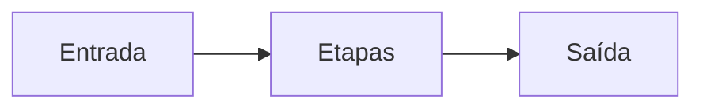

# Megila

Megila é um pipeline genérico de vídeo, escrito em Python e publicado sob a
licença MIT.

O nome vem de Jeremias 36:2: um rolo em que se escreve o que precisa
permanecer. O projeto segue essa ideia. Um vídeo entra, atravessa etapas
explícitas e sai como um resultado que dá para repetir.

## Documentação

Este site é gerado com MkDocs Material e publicado em
`https://scalet.github.io/megila/`. A navegação acompanha a pasta `docs/`:
uma página nova aparece no menu sem alteração manual do `mkdocs.yml`.

- [Instalação](instalacao.md)
- [Solução de problemas](troubleshooting.md)
- [Configuração](configuracao.md)
- [Perfis](perfis.md)
- [Segurança](seguranca.md)
- [Ambiente de desenvolvimento](dev/ambiente.md)
- [Amostras de teste](dev/amostras.md)
- [Decisões arquiteturais](adr/index.md)
- [Como escrever e visualizar a documentação](dev/docs.md)

## Código

O código-fonte está em <https://github.com/scalet/megila>, sob a
[licença MIT](https://github.com/scalet/megila/blob/main/LICENSE).
